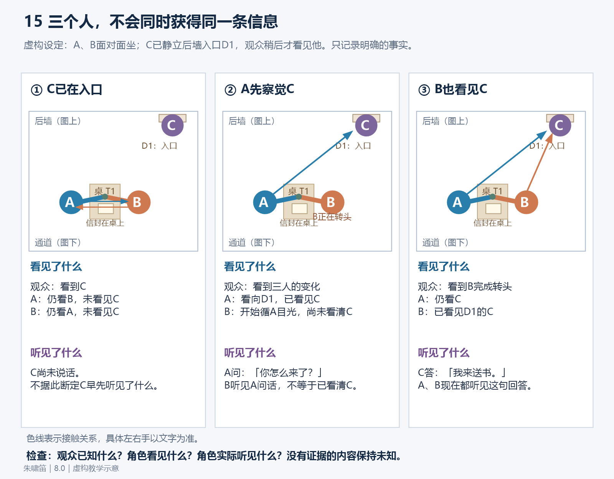
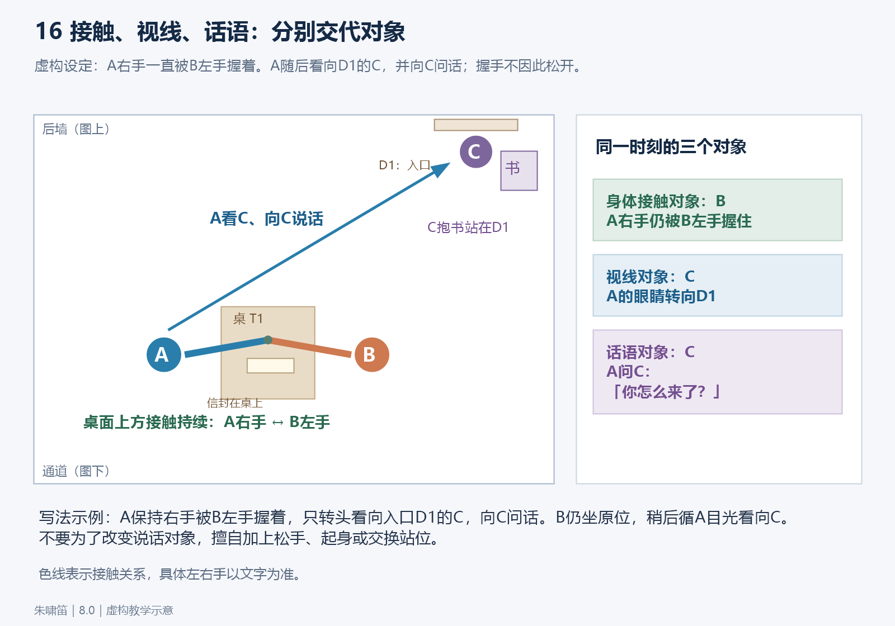
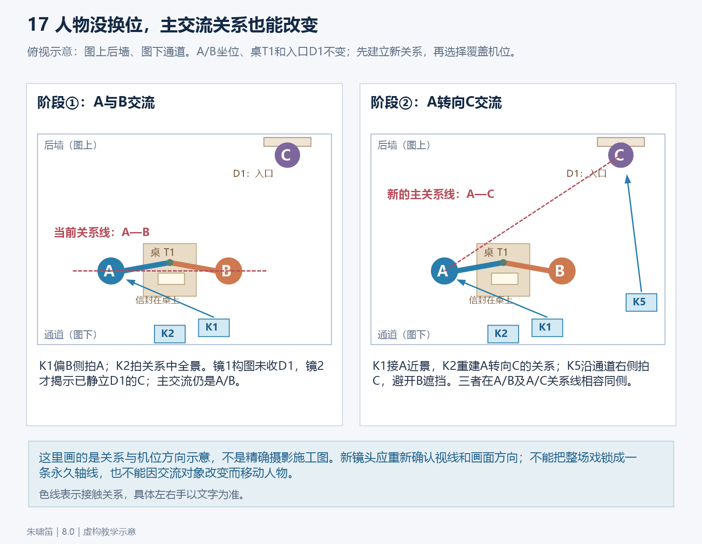
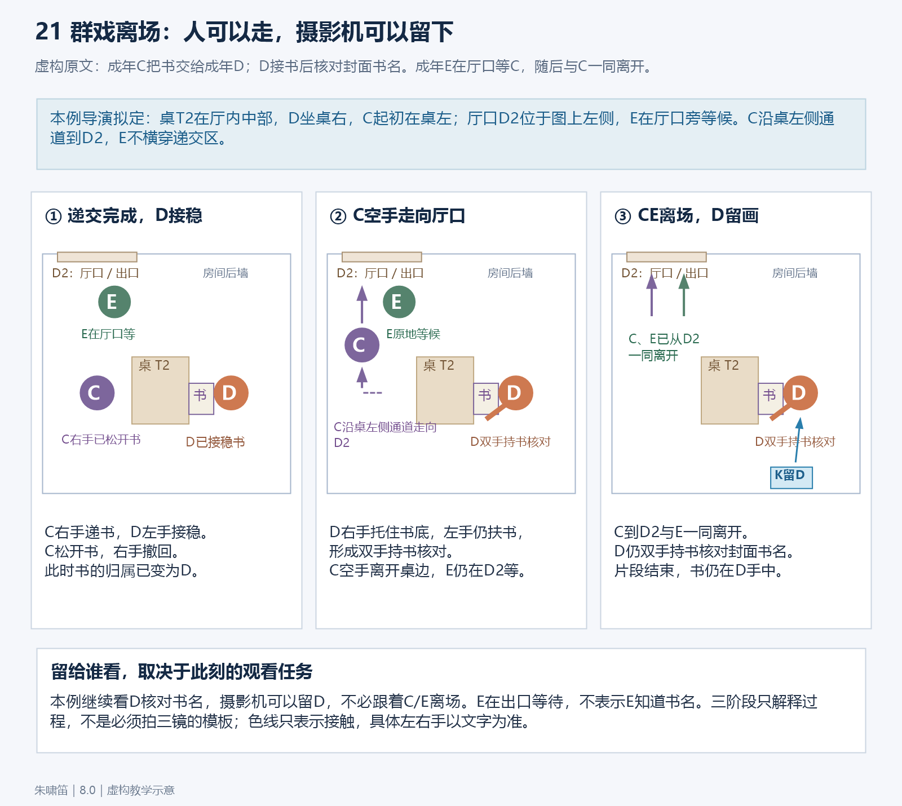
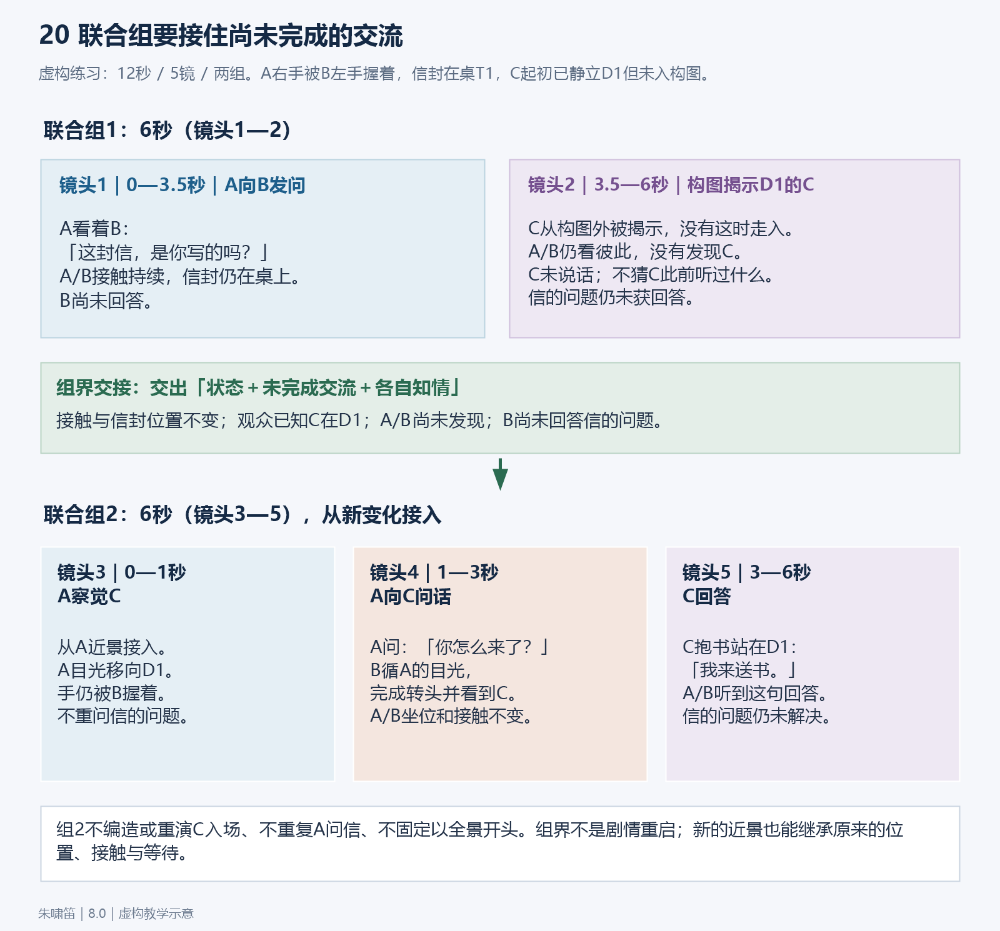

# 注意力、人物知情与多人交流｜8.0补强教学

> 文件署名水印：朱啸笛。以下均为自包含的虚构教学例子，不是待制作剧本，不得把例中人物、对白或事件移入新项目。人物均为成年人。图片用于说明关系，执行依据同时完整写在正文中；看不到图片也能理解。

本篇补足五种常见问题：观众和人物得到信息的先后不同；接触、视线和话语可以指向不同对象；主要交流对象改变时需要重新判断轴线；群戏要沿信息传递选择观看对象；联合组除身体状态外还要交接尚未完成的问答。

## 一、先分清事实、演法与未知

**事实**来自当前源文与已有镜头，例如“B的左手握着A的右手”“A尚未看见门口的C”。**演法**是把事实拍清楚的方案，例如让A先移眼再转头，或者先给观众看入口。**关键未知**是资料没有交代、却会改变后续事件的事项，例如C是否听过此前的谈话。不能用一种表演补成另一种剧情事实。

例如原文只有“A问B：这封信，是你写的吗？”时：

- 可以设计A看向B，用核对式的疑问语气说话。
- 不能直接写成“A愤怒质问撒谎的B”，因为源文没有给出愤怒、撒谎或写信人身份。
- B此刻没有台词，不等于B心虚、拒答或故意拖延。
- C在入口出现，不等于C听见了此前整句话，更不等于C知道写信人的身份。

普通机位、自然转头和适当语气由导演设计；秘密、嫉妒、误会、背叛等剧情含义必须有源文依据。遇到真正影响后续的关键未知，保留未知并定位缺口，不用表情标签替作者回答。

## 二、贯穿本篇的明确源文与空间

### 2.1 本例源文

> 日·内，书房。成年人A与成年人B面对面坐着，核对桌上一封封口信封，内容与署名均未展示。B用左手握着A的右手，接触在本片段内持续。A看着B问：“这封信，是你写的吗？”成年人C已经静默站在后墙入口D1，右手抱着一本书。先只让观众看见C，A与B都未发现。随后A抬眼看见C，问：“你怎么来了？”B这时才循着A的目光看见C。C回答A：“我来送书。”片段到此结束。

源文没有写C何时进门，也没有交代C是否听过信的问题；本例不补入场动作，不替这项未知下结论。源文没有给出B的答复，本例不能替B回答，也不能解释其未回答的动机。C回答的是A对C的来意询问，不是A对B的信件问题。

### 2.2 固定地标与坐标

本例采用房间俯视图。图上方是后墙，`y=0`；图下方是通道，`y=1`；图左至图右为`x=0—1`。坐标只是帮助教学定位，不是正式分镜必须使用的数学字段。

```text
后墙 y=0
                                      D1/C (0.85,0.10)

       A (0.25,0.65)   桌T1   B (0.65,0.65)
           面向B  →             ←  面向A
       信封在T1靠A一侧；B左手握A右手

                     K2 (0.45,0.95)
                            K1 (0.60,0.92)   K5 (0.92,0.80)
通道 y=1
```

- A、B坐在桌T1两侧，位置分别为`(0.25,0.65)`、`(0.65,0.65)`。D1唯一指定为后墙右侧入口`(0.85,0.10)`，C静立于此。
- 信封始终放在T1靠A的一侧，不拿起、不交接、不移入C手中。B左手始终握住A右手；C右手始终抱书。
- K1位于通道侧偏B一端`(0.60,0.92)`，朝A拍摄。镜1拍A，镜3从同一方向稍收景别；不把该位置错误命名为必须带B肩膀的过肩镜头。
- K2位于通道中段`(0.45,0.95)`，朝后墙拍A、B及右后方D1。镜2、镜4采用这个关系机位；A在画左，B在画右，C在右后方入口。
- K5位于通道右侧`(0.92,0.80)`，朝D1拍C。它避开B的遮挡，拍到C朝A看的三分之二侧面及右手抱书的状态。

人物的左手、右手按人物自身区分。图左/图右是俯视图方向；画左/画右是当前摄影机画面方向。镜5不能因C在俯视图右上，就机械要求C仍在画面右上。

## 三、观众先看见，不等于人物都知道



### 3.1 图怎么读

这张图要读的是**信息何时进入谁的视野**，而不是推测谁在想什么。第一次看见C的节点依次为：

1. 镜2让观众看见D1的C；A与B仍互看，二人尚未发现C。
2. 镜3让A的目光离开B，落到D1的C；这是A首次发现C的动作。
3. 镜4让B循着A的新目光看向D1；这是B首次发现C的动作。

画外有C，并不意味着人物知道C；C被摄入画面，也不意味着人物已经看见C。必须分别追踪：**观众被拍到了什么；人物实际看到了什么；人物实际听到了什么；人物已经能据此确认什么。**

### 3.2 本例的逐节点状态

| 节点 | 观众得到的信息 | A看见C了吗 | B看见C了吗 | 声音与未知 |
|---|---|---|---|---|
| 镜1：A问B信件问题 | 看见A在向B核对；入口不在构图内 | 没有，视线仍指B | 没有，视线仍指A | A的话说给B；不能据此断言C听到或未听到 |
| 镜2：关系构图露出D1 | 首次看见C已经站在入口、右手抱书 | 没有，仍看B | 没有，仍看A | C保持静默，不添加足以引发回头的脚步声、咳嗽或敲门声 |
| 镜3：A转移目光 | 看见A开始发现此前已展示的C | 在本镜动作中首次看见 | 还没有，仍看A | 无新增对白；不能提前给B发现C的反应 |
| 镜4：A问C，B循目光看去 | 看见问话对象已经改为C，也看清B发现C的时刻 | 已看见 | 在本镜循目光后首次看见 | A向C问来意；B在场听见此句。C对这句作答所需的接收由后续回答成立，不外推到此前信件问题 |
| 镜5：C答A | 确认C此次来意是送书 | 已看见，听到回答 | 已看见，听到回答 | 只确认本次回答的事实；不新增信件作者或其他消息 |

“没有看见”是本例源文明确给出的状态；“C是否听过信件问题”则是源文未确定的状态。这两种情况不能混写成同一个“未知”。

### 3.3 为什么这样接成立

镜2为观众准备了D1的空间位置与C的存在，镜3的视线变化因此有可理解的落点。镜4才让B循目光发现C，保留了源文指定的先后。人物没有瞬移，也没有共享观众的全知视角。

**反例：**镜2一见C，A与B同时猛然回头。错误在于提前改写了二人的知情时刻。另一个反例是镜3让B惊讶地看向C，镜4又让B“首次发现C”；这会把同一个认知事件做两遍。

这条方法也适用于门外来人、桌下物件、远处信号或信息屏幕：先决定信息通过视线、声音或别人转述到达谁，再选择镜头。不能用全员同步表情代替信息传递。

## 四、接触对象、视线对象、话语对象分开追踪



### 4.1 图怎么读

图中的三条关系对应三个不同问题：

- **接触关系：**谁的哪只手接触谁的哪里？本例是B左手握A右手，全片段持续。
- **视线关系：**谁此刻实际看向谁或哪件东西？本例A先看B，镜3转看C；B到镜4才看C。
- **话语关系：**这句话说给谁？本例第一句A问B，第二句A问C，第三句C答A。

三者可能重合，也可能分离。镜4的正确状态是：**A仍与B保持原有手部接触，眼睛看C，话说给C；B尚在循A目光发现C的过程中。**不需要松手、站起或把整个身体转向C才能成立。

### 4.2 逐镜写法怎样落地

先写原本的接触继续，再写当前新增的眼神和问话对象，例如：

> B左手仍握A右手，二人不换座、不松手。A已朝D1的C看去，开口问C来意；B先看A转向的方向，再把目光落到D1的C。

必要时，声音栏用“对C说”标明话语对象；角色在不在画内仍按本镜实际构图写。不要让A的脸、嘴和身体都被“保持面对B”锁死，导致他无法向C说话；也不要只写“转向C”，让生成时连握手和坐姿一起重置。

### 4.3 为什么这样接成立

源文指定的是持续的手部接触。视线转移只改变关注方向，不会自动解除接触。A转头的范围由D1的真实位置决定；手部继续由原有支撑与接触承担。镜头接续核的是各条关系各自的阶段，而不是把所有人都朝同一方向摆齐。

**反例：**A问C时突然甩开B的手，或者B为了看C先把A拉起来。两者都新增了源文没有的身体事件。也不能把“握手继续”解释成A依恋B，或把B看C解释成嫉妒；本例只规定动作与知情先后。

甜宠、争执或多人会面都可使用这张关系表，但表达强度仍由当场剧本决定。它是一种避免状态捆绑的检查方法，不是要求所有镜头都同时出现接触、视线与对白。

## 五、主要交流对象变了，轴线也要重新判断



### 5.1 图怎么读

第一阶段A向B提问，主要交流轴线是A—B。俯视图中这条线位于`y=0.65`，K1、K2与K5均在它的通道侧，即图下方。

第二阶段A发现C并向C问话，主要交流转为A—C。新轴线从A的`(0.25,0.65)`斜向D1/C的`(0.85,0.10)`。K1、K2、K5仍处于这条斜线的通道右下侧，后续拍C不需要跨到后墙另一边。图中的线表示交流关系，不是要求人物沿线走动。

本例不让人物移动，也仍然需要重新判断主要交流轴线。**人没动，不等于交流对象没变。**同时，镜2仅让观众看见C，尚未使A与C开始交流；不能仅凭C进入构图，就声称主交流已改为A—C。

### 5.2 镜头顺序

1. 镜1用K1拍A问B，建立当前问答关系。
2. 镜2用K2让观众同时认出A、B、入口D1与C，人物仍未互相发现。
3. 镜3从K1方向拍A转移目光，让变化发生在画面中。
4. 镜4回K2，看见A对着D1开口，也看见B循目光发现C；这镜把新的交流对象与旧的坐位关系一起交代清楚。
5. 镜5到K5拍C面向A回答。机位在A—C轴同侧，C的视线有明确的A作为落点。

镜4并非每次换交流对象都必须出现的固定全景。如果既有构图、连贯转头和明确话语对象已足以让观众辨认，可以用更紧的构图完成。重要的是让新关系可理解，再使用对应的近景或反打，而不是机械插一张空间全景。

### 5.3 常见反例

- 把B拍成前景肩膀，却让A看向不在那一侧的C，再把该镜写成“A与C反打”。前景是谁、目光落在哪、下一镜拍谁没有对应。
- 镜5临时跑到D1后墙外侧拍C，令C的眼线和原方向对不上，却没有任何新空间说明。
- 因为A问了C，就把B从坐位移开，甚至删除B左手与A右手的接触。
- 给A、B、C每两个人都套一组正反打，按人数轮流切，而没有判断这一句实际说给谁。

以后若源文让B再对C说话，才继续核B—C交流关系及当时适用的机位；不能提前为尚未发生的交流改站位。

## 六、完整示范：12.0秒、两组、五镜

以下是**教学片段，不是完整整集**。它精确示范五字段格式、知情先后、身体接触与组间交流接续。坐标属于本例的明确空间，不要求复制到所有正式分镜。分组是制作方案，不是时间跳跃。

给定教学节拍为：镜1为3.5秒，镜2为2.5秒；镜3为1.0秒，镜4为2.0秒，镜5为3.0秒。两联合组各6秒，总时长均为整数；单镜与切点可以用小数。第二组时间重新从0开始，全段累计时间为12.0秒。正式制作应依实际读法和观看价值调整，不把本例的气口或时长套成通用规则。

```text
联合镜头1（镜头1—2，时长6秒）
出场人物：A、B、C，均为成年人；本段普通书房会面，服装版本在两组间一致。
场景参考：教学场景S1 日·内 书房。后墙为俯视图y=0，通道为y=1；A坐在(0.25,0.65)，B坐在(0.65,0.65)，二人隔桌T1面对面。唯一入口D1位于后墙右侧(0.85,0.10)，C已静默站在D1。首态A看B、B看A，二人均未发现C；B左手握A右手。K1为通道侧偏B一端(0.60,0.92)，朝A；K2为通道中段(0.45,0.95)，朝后墙。本例无现成场景图片依赖。
道具参考：封口信封平放在桌T1靠A一侧，内容与署名均未展示，全片段不拿起、不交接；C右手抱一本书，无换手。B左手与A右手持续接触，不占用C的书。

镜头1
景别：A中近景。
机位：K1，通道侧偏B一端，朝A上半身拍摄；不收D1，不以虚构的B前景肩膀冒充过肩关系。
运镜：固定。
画面内容：组内0.0—3.5秒（本镜3.5秒）。A坐在原位看着B核对信件问题；B在画外仍坐原位，左手握A右手，接触不中断。A的疑问指向B，不提前看D1；信封在桌T1靠A侧，不因问话拿起。句末疑问完整说完后，于3.5秒硬切K2，让观众获得入口信息；不为切镜另做转头或松手。
台词／OS：A（画内，对B说，核对式询问，句尾自然上扬）：“这封信，是你写的吗？”

镜头2
景别：关系中全景。
机位：K2，通道中段朝后墙；A在画左、B在画右，桌T1位于两人之间，D1及C位于右后方。构图同时可辨持续的握手、桌上信封与C右手抱书。
运镜：固定。
画面内容：组内3.5—6.0秒（本镜2.5秒）。A、B仍面对面坐着互看，B左手握A右手；二人尚未发现C。观众在本镜首次看见D1处的C，C静立抱书，不向前走，也不以咳嗽、敲门或脚步声触发回头。镜头的新增信息是入口存在C，不是让三人同步反应。6.0秒硬切下一组首镜；交出状态为A对B的信件问题尚未获答，A/B仍互看、C已被观众看见但二人未发现，握手与持物均不变。
台词／OS：无。

联合镜头2（镜头3—5，时长6秒）
出场人物：A、B、C，均为成年人；沿用本段普通书房会面的服装版本。
场景参考：教学场景S1 日·内 书房，连续同一时刻。后墙为俯视图y=0，通道为y=1；A仍坐(0.25,0.65)，B仍坐(0.65,0.65)，桌T1在两人之间，D1唯一入口位于后墙右侧(0.85,0.10)，C已静默站在D1。上组交出A刚向B询问信件、尚未获答；本组首态A看B、B看A，二人尚未发现C，观众已知道C在入口。B左手持续握A右手。K1位于(0.60,0.92)朝A，K2位于(0.45,0.95)朝后墙；K5位于通道右侧(0.92,0.80)朝D1，避开B遮挡。所有机位都在A—B轴通道侧，并处于A—C轴的通道右下侧。本例无现成场景图片依赖。
道具参考：封口信封仍平放在T1靠A一侧，内容与署名均未展示，不拿起；C右手仍抱一本书，不换手、不递出。B左手仍握A右手，不能以转移视线为由松开。

镜头3
景别：A侧近景。
机位：K1方向，较镜1收近至A头肩；D1在画外，A由看向B的方向转向后墙右侧D1。摄影机仍位于原通道侧。
运镜：固定。
画面内容：组内0.0—1.0秒（本镜1.0秒）；累计为全段6.0—7.0秒。开镜接A尚在看B的原姿态，A目光随即从B移向后墙D1，再沿该方向轻转头，首次把视线落在C脸上。B在画外仍看A，尚未发现C；二人手部接触继续。1.0秒在A新视线落稳后硬切K2，下一镜保留A已经看见C的状态，不重做发现动作。
台词／OS：无。

镜头4
景别：关系中景。
机位：K2，通道中段朝后墙；A在画左、B在画右，D1的C在右后方，画面可理解A新视线所指。
运镜：固定。
画面内容：组内1.0—3.0秒（本镜2.0秒）；累计为全段7.0—9.0秒。A承接上一镜已经看向C的头向，直接对D1的C问话，不再演一遍看见。B先看A，随后循A的目光转看D1，这时才发现C；B左手全程握A右手，二人不换座。C仍在D1右手抱书。A的来意问句说完，于3.0秒硬切C的回答；此时A/B都已看见C，但A对B的信件问题仍没有答复。
台词／OS：A（画内，对C说，自然询问，读法不额外解释敌意或亲疏）：“你怎么来了？”

镜头5
景别：C中近景。
机位：K5，通道右侧朝D1，避开B遮挡；收C三分之二侧面及右手抱书的状态。C的目光落向坐在原位的A，不看镜头。
运镜：固定。
画面内容：组内3.0—6.0秒（本镜3.0秒）；累计为全段9.0—12.0秒。接C在D1已经受到A询问的状态，不重新入门；先让新构图中的C、右手与怀中书可辨，再自然回答A。答话期间书保持右手抱持，不举起递出，也不移到左手。句末保留交流中的自然呼吸和看向A的目光，到6.0秒直接结束这段教学片段，不冻结、不淡出，不编A/B进一步回应。A/B在画外仍坐原位，B左手握A右手；信封仍在桌T1靠A侧。交出状态为C的来意已说明，A对B的信件问题仍未获答。
台词／OS：C（画内，对A说，正常说明来意，语速自然）：“我来送书。”
```

### 6.1 精确核对

- 第一组：`3.5＋2.5＝6秒`。第二组：`1.0＋2.0＋3.0＝6秒`。全段：`6＋6＝12秒`。两组总时长均为整数且不超过30秒，逐镜区间与组头一致。
- 按发声顺序拼接，正文只有：`这封信，是你写的吗？你怎么来了？我来送书。`源文三句各出现一次，B没有被补台词，C没有回答信件问题。
- 接触链：从镜1至镜5，始终是B左手握A右手；没有松手、换手或拉人起身。
- 道具链：信封一直在T1靠A侧；书一直在C右手。没有镜头把两个物件混同。
- 发现链：镜2观众先看见C；镜3A首次看见C；镜4B首次看见C。换镜和换组都不重演发现。
- 镜5给定3.0秒包含新构图的辨认、正常回答和自然气口，不要求把四字答句拖长到3.0秒。实际制作若此处没有足够观看价值，应调整该镜与组内区间/分组，使组总时长仍为1—30秒的整数；不能把本例用作“每句话后停一段”的依据。

## 七、群戏：沿信息传递看人，不按人数轮流拍

以下是另一段独立虚构源文，不能接到上面的书房片段之后：

> 成年送书员C把书交给成年记录员D。D接书后核对封面名称。成年同伴E在厅口等C，C交书后走向厅口，与E一起离开。片段结束时，D仍在核对书名。



图21采用本例导演拟定的俯视空间：图上方为后墙，桌T2在厅内中部，C起初在桌左，D坐桌右，出口D2在图上左侧，E在出口旁等候。左右是这张俯视图的基准，不是每个摄影机里的屏幕左右。三格解释动作阶段，不规定必须切三镜。

第一格：C自身右手递书，D自身左手接稳；C松开并撤回右手，书的归属改为D。第二格：D右手托住书底、左手仍扶书，形成双手核对；C空手沿桌左通道走向D2，E在门旁等，不横穿递交区。第三格：C到D2后与E一同离开，书仍由D双手持有，K可以留D核对。这个机位不必跟随离场者；若选跟随，须有当前源文的观看理由。E在门口等候不等于他已看见或知道书名。图中的色线仅标接触关系，左右手以本段文字为准。

### 7.1 明确角色任务与行为顺序

- C的任务是完成交书，然后与E离开；书交到D手中后，C不再持书。
- D的任务是接收并核对名称；C离开不结束D的动作。
- E的任务是等C一起走；他不需要看一遍书名，也没有获知书名内容的反应任务。

可采用“交书与接收→C转向厅口，E接上离开→镜头留给D核对”的顺序。递交动作只完成一次；D核对的动作由接书结果继续。E不必为每句话轮流点头，也不能在背景中随意穿过交书区遮住关键接收。

### 7.2 离场后看谁

这段源文结束在D仍核对，因此C/E离开时，摄影机可以留给D，不必总跟着离开的人走。也可以在同一镜中让C/E走出画面，构图保留D和书；如果关键书名必须被观众读清，还需要合适的尺度、清晰度和真实文字素材。

如果另一段源文明示C出门后要完成新的关键行动，才按该行动选择跟随C。**“谁离场就跟谁”与“每次都留给留下的人”都不是通用规则。**选择依据是源文接下来要让观众看见的行动或结果。

### 7.3 为什么这样接成立与反例

衔接成立依靠物件结果与各人不同任务：D已经接书，所以能继续检查；C已经完成交付，所以能与E离开。谁持书、谁等待、谁离开分别写清，不用全体同步动作维持所谓热闹。

**反例：**C走后立刻切D，却让D手中没有书；或者D只看封面，E也突然对书名作出意味深长的表情。前者丢了接收结果，后者补了源文没有的信息与含义。若源文没有让背景角色接触、听见或看到关键内容，就不能为凑反应镜赋予他们相应认知。

## 八、联合组还要交接尚未完成的交流



### 8.1 图怎么读

图中的组界位于镜2与镜3之间。第一组结束时不是“大家坐着，姿态不变”这么简单，而是同时留下四类状态：

1. **身体状态：**A/B坐原位，B左手握A右手；C站D1右手抱书。
2. **物件状态：**信封在T1靠A侧，未拿起；书未递出。
3. **知情状态：**观众看见C；A/B尚未发现C。
4. **交流状态：**A已向B问完信件问题，B尚未作答；下一组不能把这一问当作没发生。

第二组首镜从这四项首态开始，新增的事情只有A第一次发现C。镜4再让A问C并让B发现C，镜5由C回答来意。新问答不会自动撤销第一句未获答的状态。

### 8.2 实际写在哪里

写在现有组头“场景参考”及首镜“画面内容”中，不另设正式顶层表。例如：

> 上组交出A刚向B询问信件、尚未获答；本组首态A看B、B看A，二人尚未发现C，观众已知道C在D1。B左手持续握A右手。首镜才发生A目光移向D1的动作。

这项描述必须能独立复制理解。只写“延续上一组”无法交代具体哪个问题未回答；只写“接上一组尾帧”也不能说明谁尚未看见谁。

### 8.3 为什么这样接成立

组界不是剧情中的停顿或换时段。观众不应感觉第一组结束后所有人等了一会儿，第二组才重新开始交流。A对B的问句已经发出，不能在第二组重念；A发现C是下一步变化，不能在组头提前写成“A已经看见C”，首镜再演一次。

**反例：**第二组以A重新坐正、重看信封、再问一遍信件问题开头；或第二组直接写“B回答C送书”，把发声者、回答对象与问题都错配。另一种反例是为了让每组有完整结局，强行给B补一句答案。联合组可以交出未完成的交流，不能靠改剧本闭合每组。

## 九、把方法迁移到正式项目

先按当前源文填写实际事实，再设计镜头，不把本例的五镜、两组或12秒复制成规模要求。遇到多人场景，依次核：

1. 当前句子说给谁，谁在等什么回答？
2. 观众、各角色分别已经看见和听见什么？哪项是真未知？
3. 接触、持物、视线与话语对象是否被错误绑定？
4. 主交流对象发生了什么可见或可听变化，新关系怎样让观众理解？
5. 当前构图能否看清这次信息变化，是否有必要切镜？
6. 组末留下的动作、信息和未完交流，在下一组首态是否准确继承？

这些问题用于判断，不要求每镜输出六条记录，也不要求每场都有第三人、接触或悬念。已经清楚的关系不重复建立；没有源文支持的含义不靠表情、音乐或镜头替作者编造。

---

文件署名水印：朱啸笛｜版本：8.0自包含补强教学。
